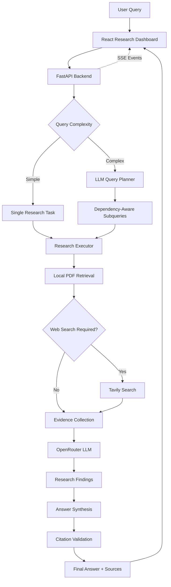
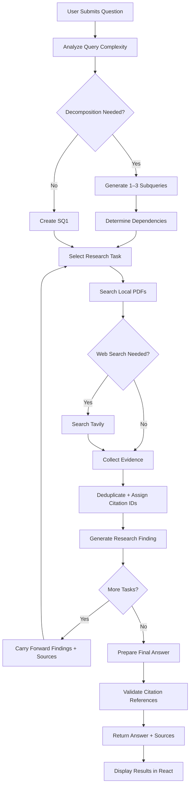

<div align="center">

# MultiHop-X
### An Adaptive, Explainable Multi-Hop AI Research Agent

**From complex questions to evidence-grounded answers — with full execution transparency.**


**[Overview](#-overview) · [Features](#-key-features) · [Architecture](#-system-architecture) · [Workflow](#-research-workflow) · [Installation](#-getting-started)**

</div>

---

## 📖 Overview

**MultiHop-X** is an adaptive AI research system designed to investigate user queries, retrieve relevant evidence from local research documents and online sources, and generate citation-supported answers.

Unlike a conventional chatbot that responds directly from model knowledge, MultiHop-X follows a structured research workflow.

The system analyzes the user's question, determines whether decomposition is necessary, retrieves supporting evidence, generates research findings, and produces a final answer with references.

Its defining feature is **execution transparency**: users can observe how their question is processed through a live research dashboard.

### The Problem

Traditional LLM-based research systems face several challenges:

- **Limited evidence grounding:** Answers may rely on the model's internal knowledge rather than verifiable sources.
- **Fixed query decomposition:** Simple questions may be unnecessarily divided into many research tasks.
- **Incomplete retrieval:** Relevant information may be absent from locally available documents.
- **Opaque execution:** Users cannot easily understand how an answer was generated.
- **Unnecessary API usage:** Excessive planning, evaluation, and retry loops can increase latency and costs.
- **Weak source traceability:** Answers may provide references without clearly identifying the evidence used.

### Our Solution

MultiHop-X addresses these problems through:

1. Adaptive query planning based on estimated question complexity.
2. Dependency-aware multi-step research when necessary.
3. Local PDF retrieval with TF-IDF relevance ranking.
4. Conditional Tavily web search for missing or weak local evidence.
5. LLM-based answer generation using retrieved evidence.
6. Citation-reference validation.
7. Live workflow visualization using Server-Sent Events.

The system prioritizes **efficient research, source traceability, and explainability**.

---

## ✨ Key Features

### 🧠 1. Adaptive Query Planning

MultiHop-X determines whether a question requires decomposition.

**Simple queries** are handled directly using one research task.

**Complex queries** may be divided into a maximum of three subqueries, depending on the planner's assessment.

This avoids generating unnecessary research tasks for straightforward questions.

Example:

**Input**
> How does ReAct differ from Retrieval-Augmented Generation?

**Research Plan**
```text
SQ1: How does ReAct differ from Retrieval-Augmented Generation?
Dependencies: []
```

For a more complex question:

**Input**
> Who discovered penicillin, and where did that scientist study?

**Possible Research Plan**
```text
SQ1: Who discovered penicillin?
Dependencies: []

SQ2: Where did the scientist identified in SQ1 study?
Dependencies: [SQ1]
```

The second task uses the first task's findings as research context.

> Note: Planning is heuristic and model-assisted. The system does not guarantee optimal decomposition for every question.

### 🔗 2. Dependency-Aware Research

MultiHop-X supports research tasks that depend on findings from earlier tasks.

Each subquery contains:

- A unique identifier.
- A focused research question.
- A list of prerequisite subqueries.

The executor processes tasks in order and carries relevant previous findings and source references forward.

This enables the system to handle questions where the answer to one step helps investigate another.

### 📚 3. Local Document Retrieval

The system can retrieve information directly from uploaded PDF documents.

The document retrieval pipeline performs:

1. PDF text extraction using PyMuPDF.
2. Text cleaning and chunking.
3. TF-IDF vectorization.
4. Query vectorization.
5. Similarity-based ranking.
6. Selection of relevant document passages.

Retrieved passages include document names and page numbers for traceability.

### 🌐 4. Tavily Web Search Fallback

Local documents may not contain everything required to answer a question.

MultiHop-X uses Tavily when:

- No relevant local passages are retrieved.
- The strongest local similarity score is below the configured threshold.
- The query is recognized as a comparison.

The resulting evidence can include both local document passages and online sources.

The current implementation uses retrieval-score heuristics rather than a separate semantic sufficiency critic.

### 🤖 5. Evidence-Grounded Answer Generation

Retrieved passages are supplied to an LLM through OpenRouter.

The model is instructed to:

- Answer the user's question directly.
- Ground responses in supplied evidence.
- Use valid source references.
- Avoid inventing citations.
- Disclose missing or incomplete evidence.

A single research task can produce the final answer directly.

Multiple research tasks use an additional synthesis step to combine their findings.

### ✅ 6. Citation-Reference Checking

MultiHop-X assigns citation identifiers to retrieved sources:

```text
[S1] ReAct research paper — Page 4
[S2] RAG research paper — Page 2
[S3] External web source
```

The system checks whether citations used in the generated answer correspond to sources actually retrieved.

This helps identify fabricated source identifiers.

**Important:** Citation validation checks reference existence. It does not independently establish that every factual claim is supported by the cited passage.

### 📡 7. Live Execution Tracking

The frontend displays backend execution updates as they occur.

Users can inspect:

- The current research stage.
- Running, completed, skipped, or failed operations.
- Generated subqueries and dependencies.
- Local document retrieval activity.
- Tavily search activity.
- Answer generation and synthesis.
- Citation validation.
- A chronological execution timeline.

The system uses **Server-Sent Events (SSE)** to deliver progress updates from FastAPI to React.

---

## 🏗️ System Architecture

MultiHop-X follows a modular research pipeline with a React frontend, FastAPI backend, retrieval layer, LLM integration, and citation checking.



### Main Components

| Component | Responsibility |
|-----------|----------------|
| React Frontend | Research interface, live workflow visualization, and answer presentation |
| FastAPI Backend | API requests, research orchestration, and SSE streaming |
| Query Complexity Analyzer | Determines whether planning is required |
| Adaptive Planner | Generates focused research tasks and dependencies |
| Research Executor | Executes tasks and incorporates prerequisite findings |
| PDF Retrieval Engine | Extracts, indexes, and searches local documents |
| Tavily Integration | Retrieves external evidence when required |
| OpenRouter Integration | Provides access to the configured LLM |
| Answer Synthesizer | Combines findings into a final response |
| Citation Validator | Checks references against retrieved source IDs |
| Execution Tracker | Publishes and displays research-stage updates |

---

## 🔄 Research Workflow

The following workflow explains how a question moves through the complete system.



### Step 1 — Query Analysis

The system receives the user's question and evaluates whether it appears simple or complex.

Simple questions bypass the LLM planning call.

Questions involving multiple research objectives or dependent reasoning can be routed to the adaptive planner.

### Step 2 — Adaptive Decomposition

For complex questions, the planner generates a structured plan.

Each task includes its question and dependencies.

Example:

```json
{
  "subqueries": [
    {
      "id": "SQ1",
      "question": "Who discovered penicillin?",
      "depends_on": []
    },
    {
      "id": "SQ2",
      "question": "Where did the scientist identified in SQ1 study?",
      "depends_on": ["SQ1"]
    }
  ]
}
```

### Step 3 — Local Evidence Retrieval

The executor searches uploaded PDFs using TF-IDF similarity.

Relevant chunks are selected along with document metadata.

### Step 4 — Web Retrieval Decision

The system checks whether web retrieval should be performed.

If local retrieval returns insufficient matches according to its heuristics, Tavily is invoked.

Comparison questions also trigger Tavily retrieval.

### Step 5 — Evidence Collection

The system combines local and web search results.

Duplicate sources are removed, and source identifiers are assigned.

Example:

```text
S1 → ReAct.pdf, Page 3
S2 → RAG.pdf, Page 5
S3 → External research article
```

### Step 6 — Research Finding Generation

The LLM receives:

- The current research question.
- Retrieved evidence passages.
- Existing findings from prerequisite tasks.
- Available citation identifiers.

It generates a finding grounded in the supplied information.

### Step 7 — Multi-Hop Continuation

If additional research tasks remain, the executor continues with the next task.

Dependent tasks receive relevant earlier findings and references.

### Step 8 — Final Synthesis

For a single task, the existing finding is used directly.

For multiple tasks, the synthesizer combines the findings into a final response.

### Step 9 — Citation Validation

Citation IDs in the answer are compared with the retrieved source registry.

Unknown or missing citation references are reported.

### Step 10 — Result Presentation

The final response contains the answer, retrieved sources, citation-check status, and any retrieval warnings.

Throughout execution, progress events are delivered to the React dashboard.

---

## 📡 Real-Time Execution Tracking

One of the most important features of MultiHop-X is its live execution trace.

The backend emits named events such as:

```text
started
node_update
node_update
node_update
...
completed
```

A typical event looks like:

```json
{
  "node": "documents",
  "status": "completed",
  "hop_id": "SQ1",
  "source_count": 6,
  "message": "Found 6 local document passages"
}
```

The frontend consumes the SSE stream and updates the workflow visualization.

### Tracked Stages

```text
Query Planner
     |
     v
Document Search
     |
     v
Tavily Search (if required)
     |
     v
Research Agent
     |
     v
Answer Synthesis
     |
     v
Citation Check
     |
     v
Final Answer
```

The dashboard also shows a chronological event timeline so users can follow the research process instead of receiving only a final answer.

---

## 🛠️ Technology Stack

| Layer | Technology |
|-------|------------|
| Frontend | React, JavaScript, CSS |
| Frontend Development | Vite |
| Backend | Python, FastAPI |
| LLM Gateway | OpenRouter |
| Web Retrieval | Tavily API |
| Local Document Parsing | PyMuPDF |
| Local Document Search | TF-IDF, scikit-learn |
| Numerical Processing | NumPy |
| API Communication | HTTP and Server-Sent Events |
| HTTP Client | HTTPX |
| Environment Configuration | python-dotenv |

The active pipeline is implemented in `backend/main.py`.

Earlier experimental agent components may still be present in the repository, but they are not required for this simplified execution path.

---

## 📁 Project Structure

The active application uses the following files:

```text
MultiHop-agent/
|
├── backend/
│   ├── __init__.py
│   └── main.py               # Active research API and pipeline
|
├── frontend/
│   ├── src/
│   │   ├── App.jsx           # Research UI and live tracking
│   │   ├── main.jsx          # React entry point
│   │   └── style.css         # Dashboard styling
│   |
│   ├── package.json
│   └── index.html
|
├── data/
│   └── documents/            # Local research PDFs
|
├── requirements.txt
├── .gitignore
├── .env                      # Local secrets (not committed)
└── README.md
```

Additional legacy modules, tests, and experimental files may exist alongside this active structure.

---

## 🚀 Getting Started

### Prerequisites

Ensure the following are installed:

- Python 3.10 or newer.
- Node.js and npm (Node.js 20+ recommended).
- Git.
- An OpenRouter API key.
- A Tavily API key.

### 1. Clone the Repository

```bash
git clone https://github.com/alobroke/MultiHop-agent.git
cd MultiHop-agent
```

### 2. Create a Python Virtual Environment

On Windows PowerShell:

```powershell
python -m venv .venv
.\.venv\Scripts\Activate.ps1
```

### 3. Install Backend Dependencies

```powershell
python -m pip install fastapi "uvicorn[standard]" python-dotenv httpx pymupdf numpy scikit-learn
```

These are the dependencies used by the active `backend/main.py`.

The repository's broader `requirements.txt` may also contain dependencies for earlier experimental components.

### 4. Configure API Keys

Create a `.env` file in the project root:

```dotenv
OPENROUTER_API_KEY=your_openrouter_api_key
OPENROUTER_MODEL=your_available_model_id
TAVILY_API_KEY=your_tavily_api_key
```

Obtain keys from:

- OpenRouter: https://openrouter.ai/
- Tavily: https://tavily.com/

Use an OpenRouter model available to your account.

Never commit API keys to GitHub.

### 5. Add Research Documents

Place PDF files inside:

```text
data/documents/
```

Example:

```text
data/documents/
├── React.pdf
├── RAG.pdf
└── llm.pdf
```

The backend automatically builds an in-memory TF-IDF index from readable PDFs.

The index is cached after initialization. Restart the backend after adding or replacing PDF files.

### 6. Start the Backend

From the repository root:

```powershell
python -m uvicorn backend.main:app --reload
```

Backend URL:

```text
http://127.0.0.1:8000
```

Health check:

```text
http://127.0.0.1:8000/health
```

Interactive API documentation:

```text
http://127.0.0.1:8000/docs
```

### 7. Start the Frontend

Open another terminal:

```powershell
cd frontend
npm install
npm run dev
```

Frontend URL:

```text
http://127.0.0.1:5173
```

Open the frontend in your browser and submit a research question.

---

## 🔌 API Endpoints

### `GET /health`

Checks whether the backend is running.

### `POST /research`

Executes a research request and returns the final result.

Example request:

```json
{
  "query": "How does ReAct differ from RAG?"
}
```

### `POST /research/stream`

Executes research while streaming progress updates.

This endpoint is used by the React dashboard.

The SSE stream can include:

| Event | Description |
|-------|-------------|
| `started` | Research session initialized |
| `node_update` | Research-stage status update |
| `completed` | Final answer and supporting metadata available |
| `failed` | Research stopped because of an error |

---

## 🧪 Example Research Questions

### Example 1 — Simple Factual Query

> What is the ReAct framework?

Expected workflow:

```text
Query Analysis
     ↓
Single Research Task
     ↓
PDF Retrieval
     ↓
Web Search if Needed
     ↓
Answer Generation
     ↓
Citation Check
```

### Example 2 — Comparison Query

> How does ReAct differ from Retrieval-Augmented Generation?

Expected workflow:

```text
Single Comparison Task
         ↓
Local Document Search
         ↓
Tavily Web Search
         ↓
Combine Evidence
         ↓
Generate Comparison
         ↓
Citation Check
```

### Example 3 — Dependent Multi-Hop Query

> Who discovered penicillin, and where did that scientist study?

Possible workflow:

```text
SQ1: Identify the scientist
          |
          v
SQ2: Investigate the scientist's education
          |
          v
Final Answer
```

These examples illustrate intended behavior; the exact plan and output depend on the question, model, and available evidence.

---

## ⚡ Design Decisions

### Why Adaptive Planning?

A fixed number of subqueries makes simple questions unnecessarily expensive.

MultiHop-X attempts to match research effort to query complexity.

This helps reduce avoidable model calls and makes the execution plan easier to understand.

### Why Local-First Retrieval?

Uploaded research papers can provide targeted evidence without requiring every question to trigger a web request.

Local-first retrieval reduces unnecessary external searches and preserves document-level source information.

### Why Tavily Fallback?

Local research documents have limited coverage.

Tavily provides access to external sources when local results are missing, weak, or need broader comparison coverage.

### Why Server-Sent Events?

Research operations can involve several sequential stages.

SSE allows the backend to send progress updates to the frontend over a single streaming HTTP response.

This makes agent execution visible to the user.

### Why a Lightweight Citation Check?

The current design prioritizes a deterministic, low-overhead check of citation identifiers.

Unlike an additional LLM-based critic, citation-reference validation does not require another model request.

However, stronger factual verification remains an area for future improvement.

---

## ⚠️ Current Limitations

MultiHop-X is an evolving research prototype.

Its current limitations include:

1. **Heuristic complexity detection:** The planner may not always select the optimal number of research tasks.
2. **TF-IDF retrieval:** Lexical similarity may miss semantically relevant passages with different terminology.
3. **Retrieval sufficiency:** Similarity thresholds do not guarantee that the retrieved evidence fully answers the question.
4. **Citation validation:** Valid citation identifiers do not prove factual correctness.
5. **LLM dependency:** Model availability, output quality, rate limits, and account quotas affect reliability.
6. **PDF extraction:** Scanned or image-only PDFs may require OCR, which is not part of the active pipeline.
7. **Document indexing:** The cached local index requires a backend restart to reflect document changes.
8. **Execution persistence:** The active simplified pipeline does not persist research history or execution checkpoints.
9. **Sequential execution:** Dependent research tasks are executed sequentially; parallel scheduling is not implemented in the active pipeline.

These limitations define practical directions for future development.

---

## 🔮 Future Enhancements

Potential improvements include:

- Semantic retrieval using sentence embeddings.
- Hybrid lexical and vector search.
- Source reranking and relevance filtering.
- Improved adaptive planning with a query-complexity classifier.
- Stronger dependency resolution for complex research questions.
- Claim-level factual verification.
- Contradiction detection across evidence sources.
- Persistent research sessions and execution history.
- Research graph visualization with dependency edges.
- PDF upload and automatic reindexing from the frontend.
- Benchmarking retrieval quality and answer faithfulness.
- More robust protection against prompt injection in retrieved content.
- Cost-aware model routing and per-query API budgets.

---

## 🔒 Security Considerations

MultiHop-X uses environment variables for API credentials.

Recommended practices:

- Never commit `.env` files.
- Never expose API keys to frontend JavaScript.
- Treat retrieved documents and webpages as untrusted data.
- Avoid executing instructions found inside retrieved content.
- Restrict citation identifiers to actual retrieved sources.
- Review external URLs before relying on their contents.
- Add authentication and rate limiting before deploying the API publicly.

The current research prompt instructs the LLM to treat retrieved evidence as data rather than executable instructions. Prompt-based protections alone are not a complete security boundary.

---

## 🎯 Project Objective

The primary objective of MultiHop-X is to demonstrate how an AI research system can combine **adaptive planning, dependent reasoning, hybrid evidence retrieval, and transparent execution tracking** into a practical workflow.

The project emphasizes not only producing an answer, but also making the research process understandable and inspectable.

---


<div align="center">

### MultiHop-X

**Intelligent Research. Adaptive Reasoning. Transparent Execution.**

Built with Python, FastAPI, React, OpenRouter, and Tavily.

</div>
